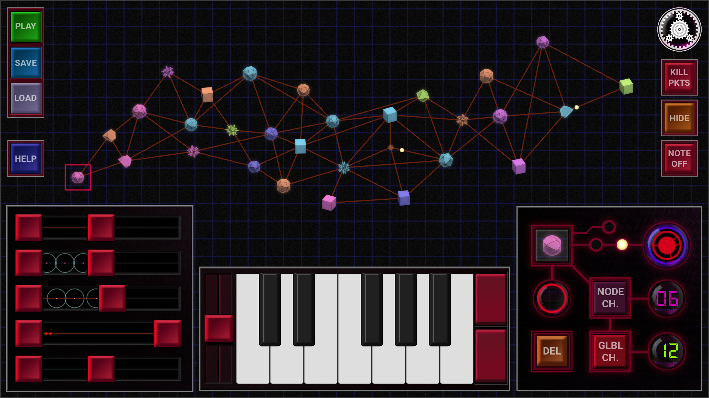

# MIDI Mesh

An open-source, cross-platform MIDI sequencing application. Inspired by mesh networks.

Primarily created for Android, but can be run on desktop with native python (developed with python version 3.11.9, runs fine with 3.12).

Currently, the app has been tested on Android and Debian. However, I've attempted to provide allowances for it to 'just work' on other platforms (adjust your commands if needed). Please provide feedback if you got it working (or not) on other platforms.

## Android:

Download the APK from the [Releases](https://github.com/EmergentProperly/MIDIMesh/releases) page and install on-device or via ADB: 

`#On linux, from the directory where the APK resides`

`adb install midimesh-x.x.x.apk`

`Where 'x.x.x' reflects the release version you are installing`

If you're adventurous, feel free to build for Android using Buildozer (or p4a directly) using the relevant documentation for your build environment of choice.

## To run out of the box on desktop:

On Debian systems, install the dependancies for python-rtmidi:

`sudo apt update`

`sudo apt install build-essential libasound2-dev libjack-jackd2-dev`

### Clone the repository:

`git clone https://github.com/EmergentProperly/MIDIMesh.git`

`cd /MIDIMesh`

### Create the environment:

`python3 -m venv venv`

`source venv/bin/activate`

### Install requirements.txt:

`pip install -r requirements.txt`

### Run:

`python3 main.py`

## ROADMAP (to 1.0):

- Whittle away the monolithic modules [In progress]

- Clean up and replace some assets and improve usability [Pending]

- Fix emergent bugs [In progress]

- Upgrade python codebase to newer version (when necessary) [pending]

Note: Progress slowed momentarily, but hasn't ceased. 

## Feedback:

Please share feedback regarding your experience with the app, and any issues you may have faced. I want this to be an awesome tool for creatives, so all rational feedback and/or feature requests will be considered carefully and appreciated.

Have fun!

## Licensing & Attributions:

This project is licensed under the GNU GPL v3. It utilizes several open-source libraries, including Kivy, Mido, and python-rtmidi. See NOTICES.md for full third-party license details.
